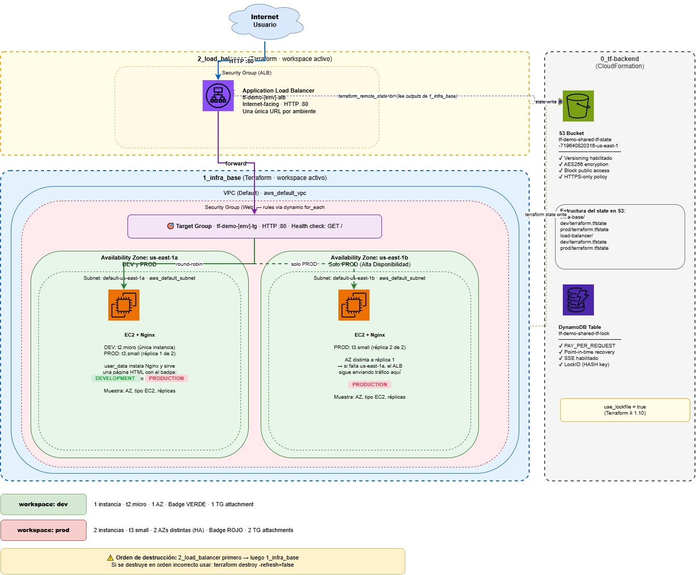

# Terraform IaC Demo — Multi-ambiente con Workspaces

Proyecto de ejemplo que demuestra buenas prácticas de Infrastructure as Code (IaC) con Terraform y AWS. Despliega servidores web Nginx en ambientes **DEV** y **PROD** completamente separados, con un Load Balancer centralizado y estado remoto en S3.

[Haz clic aquí para ver la presentación](https://canva.link/0z3icif4xuwuh9r)
---

## Arquitectura general

```
┌─────────────────────────────────────────────────────────┐
│                        INTERNET                         │
└─────────────────────────┬───────────────────────────────┘
                          │ HTTP :80
                          ▼
              ┌───────────────────────┐
              │  Application Load     │  ← 2_load_balancer
              │  Balancer (ALB)       │    una sola URL
              └──────────┬────────────┘
                         │ round-robin
              ┌──────────┴────────────┐
              ▼                       ▼
   ┌──────────────────┐   ┌──────────────────┐
   │  EC2 + Nginx     │   │  EC2 + Nginx     │  ← 1_infra_base
   │  us-east-1a      │   │  us-east-1b      │    (solo en PROD)
   │  PRODUCTION      │   │  PRODUCTION      │
   └──────────────────┘   └──────────────────┘

   DEV: 1 instancia en us-east-1a (t2.micro)
   PROD: 2 instancias en AZs distintas (t3.small) → Alta Disponibilidad
```

```
┌──────────────────────────────────────────────────────────────┐
│  S3 Bucket (tf-demo-shared-tf-state-<account-id>-us-east-1) │
│                                                              │
│  infra-base/                                                 │
│  ├── dev/terraform.tfstate   ← state de 1_infra_base DEV    │
│  └── prod/terraform.tfstate  ← state de 1_infra_base PROD   │
│                                                              │
│  load-balancer/                                              │
│  ├── dev/terraform.tfstate   ← state de 2_load_balancer DEV │
│  └── prod/terraform.tfstate  ← state 2_load_balancer PROD   │
└──────────────────────────────────────────────────────────────┘
```
---

## Diagrama de Arquitectura

---

## Estructura del repositorio

```
Terraform/
├── 0_tf-backend/
│   └── backend.yaml          # CloudFormation: S3 + DynamoDB para el state remoto
│
├── 1_infra_base/
│   ├── main.tf               # VPC, Subnets por AZ, Security Group, EC2
│   ├── locals.tf             # Configuración por ambiente + expresiones for
│   ├── variables.tf          # Variables del módulo
│   ├── outputs.tf            # Outputs (incluye los que consume 2_load_balancer)
│   └── user_data.sh.tpl      # Script de EC2: instala Nginx y genera la página web
│
└── 2_load_balancer/
    ├── main.tf               # terraform_remote_state + ALB + Target Group + Listener
    ├── variables.tf          # Variables del módulo
    └── outputs.tf            # URL del ALB
```

---

## Conceptos clave demostrados

### 1. Terraform Workspaces

Un único código base genera infraestructura diferente según el workspace activo. No hay dos carpetas `dev/` y `prod/` — todo vive en los mismos archivos y el workspace actúa como selector.

```hcl
# locals.tf — la configuración se elige con terraform.workspace
config = local.env_config[terraform.workspace]
```

| Workspace | Instance type | Réplicas | Color web |
|-----------|--------------|----------|-----------|
| `dev`     | t2.micro     | 1        | Verde     |
| `prod`    | t3.small     | 2        | Rojo      |

### 2. Uso de `for` en tres patrones distintos

**a) `for` expression para construir un mapa de tags desde listas paralelas**
```hcl
# locals.tf
tag_keys   = ["Environment", "Project", "ManagedBy", "CostCenter"]
tag_values = [terraform.workspace, var.project_name, "terraform", "IT-${upper(terraform.workspace)}"]

resource_tags = { for i, k in local.tag_keys : k => local.tag_values[i] }
# Resultado: { Environment = "prod", Project = "tf-demo", ... }
```
Sin el `for`, habría que escribir cada par clave-valor a mano. Agregar un nuevo tag solo requiere añadir un elemento a cada lista.

**b) `dynamic` block con `for_each` para reglas de Security Group**
```hcl
# main.tf — genera 3 reglas ingress (HTTP, HTTPS, SSH) desde un mapa
dynamic "ingress" {
  for_each = local.sg_ingress_rules   # mapa definido en locals.tf
  content {
    from_port   = ingress.value.from_port
    to_port     = ingress.value.to_port
    protocol    = ingress.value.protocol
    cidr_blocks = ingress.value.cidr_blocks
  }
}
```
Sin `for_each`, habría tres bloques `ingress {}` idénticos en estructura. Para agregar un puerto nuevo, solo se agrega una entrada al mapa.

**c) `for_each` con `range` para crear N instancias según el ambiente**
```hcl
# main.tf — crea 1 instancia en dev, 2 en prod (en AZs distintas)
resource "aws_instance" "web" {
  for_each = toset(slice(data.aws_availability_zones.available.names, 0, local.config.replicas))
  ...
  availability_zone = each.key   # cada instancia en su propia AZ
}
```
`slice(..., 0, replicas)` toma las primeras N Availability Zones disponibles. En `prod` (replicas = 2) genera `["us-east-1a", "us-east-1b"]`. Mismo código, distinto resultado.

### 3. Alta Disponibilidad con Availability Zones

Las instancias de PROD se despliegan en **AZs distintas** dentro de la misma región. Esto protege contra la caída de un data center físico sin la complejidad de múltiples regiones (que sería Disaster Recovery, no HA).

### 4. `terraform_remote_state` para comunicación entre módulos

`2_load_balancer` lee los outputs de `1_infra_base` directamente desde S3, sin hardcodear IDs. Si el workspace activo es `prod`, automáticamente lee el state de prod.

```hcl
data "terraform_remote_state" "infra" {
  backend   = "s3"
  config    = { bucket = var.tf_state_bucket, ... workspace_key_prefix = "infra-base" }
  workspace = terraform.workspace   # ← clave: lee el workspace correcto
}

# Los IDs de instancias vienen del state, no hardcodeados
resource "aws_lb_target_group_attachment" "web" {
  for_each = local.infra.instance_ids   # { "us-east-1a" => "i-xxx", "us-east-1b" => "i-yyy" }
  target_id = each.value
}
```

### 5. Backend S3 con `use_lockfile`

El estado de Terraform se guarda en S3 con bloqueo nativo (Terraform >= 1.10). Esto permite que múltiples personas trabajen sobre la misma infraestructura sin pisar cambios simultáneos.

```
workspace_key_prefix = "infra-base"   →  infra-base/prod/terraform.tfstate
workspace_key_prefix = "load-balancer" →  load-balancer/prod/terraform.tfstate
```

---

## Prerrequisitos

- [Terraform](https://developer.hashicorp.com/terraform/install) >= 1.10
- [AWS CLI](https://docs.aws.amazon.com/cli/latest/userguide/install-cliv2.html) configurado (`aws configure`)
- Credenciales AWS con permisos sobre: EC2, VPC, ALB, S3, DynamoDB, CloudFormation

---

## Paso a paso: despliegue completo

### Paso 0 — Backend: crear S3 y DynamoDB con CloudFormation

Este paso es **único** (se hace una sola vez). Crea el bucket S3 y la tabla DynamoDB que guardarán el estado de Terraform de todos los módulos.

```bash
# Desplegar el stack de CloudFormation
aws cloudformation deploy \
  --template-file 0_tf-backend/backend.yaml \
  --stack-name tf-demo-backend \
  --parameter-overrides \
      Identifier=tf-demo \
      Environment=shared \
      Project=terraform-demo

# Obtener el nombre del bucket creado
aws cloudformation describe-stacks \
  --stack-name tf-demo-backend \
  --query "Stacks[0].Outputs[?OutputKey=='TerraformStateBucketName'].OutputValue" \
  --output text
```

Reemplazar `BUCKET_NAME_FROM_CF_OUTPUT` en los archivos:
- `1_infra_base/main.tf` → bloque `backend "s3"`
- `2_load_balancer/main.tf` → bloque `backend "s3"`
- `2_load_balancer/variables.tf` → default de `tf_state_bucket`

### Paso 1 — Infra base: desplegar DEV

```bash
cd 1_infra_base

terraform init               # descarga providers y configura el backend S3

terraform workspace new dev  # crea el workspace dev (solo la primera vez)
terraform workspace select dev

terraform plan               # previsualizar cambios
terraform apply              # crear: VPC, Subnets, SG, 1 EC2 en us-east-1a
```

Al terminar, el output `public_urls` muestra la IP de la instancia DEV directamente.

### Paso 2 — Infra base: desplegar PROD

```bash
# Desde 1_infra_base/
terraform workspace new prod  # solo la primera vez
terraform workspace select prod

terraform plan
terraform apply               # crear: VPC, Subnets, SG, 2 EC2 en AZs distintas
```

### Paso 3 — Load Balancer: desplegar

```bash
cd ../2_load_balancer

terraform init

# PROD (2 instancias balanceadas)
terraform workspace new prod
terraform workspace select prod
terraform plan
terraform apply

# DEV (1 instancia)
terraform workspace new dev
terraform workspace select dev
terraform plan
terraform apply
```

El output `alb_url` devuelve la **única URL** de cada ambiente.

---

## Verificación

Abrir la URL del ALB en el browser. La página muestra:

| Campo | DEV | PROD |
|-------|-----|------|
| Badge | Verde `DEVELOPMENT` | Rojo `PRODUCTION` |
| Availability Zone | us-east-1a | us-east-1a o us-east-1b (round-robin) |
| Instancias totales | 1 | 2 |
| Tipo EC2 | t2.micro | t3.small |

Refrescar varias veces en PROD: el ALB alterna entre las dos AZs.

---

## Paso a paso: destruir

> **Importante:** siempre destruir en orden inverso al despliegue. `2_load_balancer` depende de `1_infra_base`; destruir `1_infra_base` primero deja el state de `2_load_balancer` inconsistente.

```bash
# 1. Primero: destruir el load balancer
cd 2_load_balancer
terraform workspace select prod && terraform destroy
terraform workspace select dev  && terraform destroy

# 2. Después: destruir la infra base
cd ../1_infra_base
terraform workspace select prod && terraform destroy
terraform workspace select dev  && terraform destroy
```

### Si destruiste 1_infra_base antes que 2_load_balancer

El remote state quedará vacío y `terraform destroy` fallará con `object with no attributes`. Solución:

```bash
cd 2_load_balancer
terraform destroy -refresh=false   # usa el state local sin releer el remote
```

---

## Referencia de comandos útiles

```bash
# Ver todos los workspaces disponibles
terraform workspace list

# Cambiar de workspace
terraform workspace select <nombre>

# Ver el state actual
terraform state list

# Ver outputs del módulo activo
terraform output

# Forzar refresco de outputs en 1_infra_base (necesario antes de ejecutar 2_load_balancer)
terraform apply -refresh-only
```

---

## Estructura del estado en S3

```
s3://tf-demo-shared-tf-state-<account-id>-us-east-1/
│
├── infra-base/
│   ├── dev/terraform.tfstate
│   └── prod/terraform.tfstate
│
└── load-balancer/
    ├── dev/terraform.tfstate
    └── prod/terraform.tfstate
```

Cada workspace tiene su propio archivo de state, completamente aislado. Un `terraform destroy` en `dev` nunca puede afectar los recursos de `prod`.
